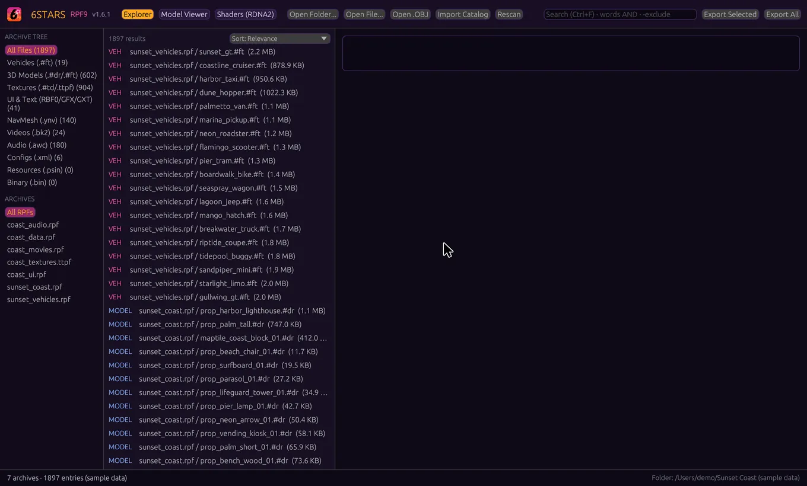
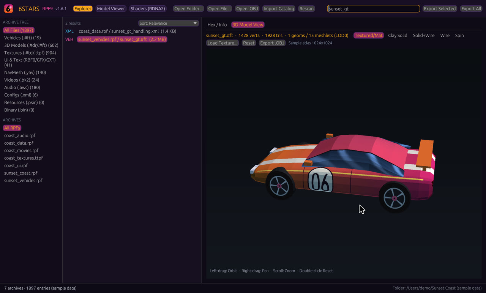

<p align="center">
  
</p>

<h1 align="center">6Stars</h1>

<p align="center">
  A Rust explorer for RPF9 and TTPF archives you already have on disk, built on <a href="https://github.com/rpatty-dev/PercyStar">PercyStar</a> by rpatty-dev.
</p>

<p align="center">
  
  
  
  
  
  
  
  <a href="#license"></a>
</p>

> [!IMPORTANT]
> **Unofficial and unaffiliated.** 6Stars is an independent research tool. It is not affiliated with, endorsed by, or sponsored by Rockstar Games, Take-Two Interactive, Microsoft / Xbox, Sony Interactive Entertainment, Epic Games / RAD Game Tools, AMD, or any other game company or platform holder. It ships no game files, no keys and no decryption code, and it never shares files. It only reads unencrypted files you supply. [Details](#legal-notice)

<p align="center">
  <br />
  <sub>Every model, texture and name in these demos is a made-up sample generated by <a href="scripts/demo_data.py"><code>scripts/demo_data.py</code></a>. No game assets are shown.</sub>
</p>

## Contribute

We'd love help with 6Stars. If you found a bug, figured out part of a file format, or got something working on a machine we haven't tested, [open an issue](https://github.com/Ahmet-Dedeler/6Stars/issues/new). Small PRs and first-time contributors are welcome. The [contributing guide](CONTRIBUTING.md) covers what to send and which code you can patch.

## What This Fork Adds

- **BK2 video on Apple Silicon and Windows x64:** Open **Videos** from the Model Viewer or **Videos (.bk2)** in Explorer, then select a clip to play it. Both build scripts include the decoder, so there's no second app to install. On Windows, click the video and press Space to pause, or use its slider to seek.
- **AWC audio previews:** Play and seek through individual streams without exporting them first. The decoder also reads multichannel banks and files with extra stream-table headers that upstream can miss.
- **Better 3D previews:** Drawables in a model dictionary appear separately instead of stacked on top of each other. Fixed rotated meshes and false model entries, added streamed `.ttpf` textures and vehicle paint previews, and added a **Highest detail only** toggle for character and clothing models.
- **More accurate model colors:** The viewer finds shared textures across packs, binds them to the right materials, and reads both packed and floating-point UVs. If it can't find a usable color texture, it shows that part in gray. When a texture's full-size mip is BCPack (which isn't decoded yet), it falls back to the largest smaller mip stored plainly. That recovers about a third of blocked textures, labeled **Reduced resolution**.
- **Open files directly:** Use **Open File...**, drag files into 6Stars, or choose 6Stars in **Open With**. This works for `.rpf`, `.ttpf`, `.bk2`, `.awc`, `.obj`, and `.ps09`. Models and shader caches open in their own tabs. Standalone videos and sound banks are added to the current list.
- **Easier browsing:** Search matches file types, so "video" or "sound" finds clips with generated names. Model names that match no rule go to **Uncategorized** instead of World / Map. Sort the Explorer and Model Viewer by name or size. Small text tables show their strings instead of hex, and binary blobs no longer show up as XML just because they start with `<`.

## Build from Source

```sh
git clone https://github.com/Ahmet-Dedeler/6Stars.git
cd 6Stars
```

<details>
<summary><b>macOS</b> (Apple Silicon, macOS 12+)</summary>

1. Install Rust via `rustup`, Python 3, and the Xcode Command Line Tools.
2. Run `bash scripts/build_macos.sh`.
3. Open `dist/6Stars.app`.

The script fetches and verifies the pinned decoder and frame bridge, so video playback works offline. The app also builds for Intel, but the bundled decoder is ARM-only.

</details>

<details>
<summary><b>Windows x64</b></summary>

1. Install Rust, the Visual Studio C++ Build Tools, and 7-Zip.
2. In PowerShell, run `powershell -ExecutionPolicy Bypass -File .\scripts\build_windows.ps1`.
3. Open `dist\6Stars-Win64\6Stars.exe`.

The build fetches and verifies RAD's decoder and puts it next to 6Stars without running the RAD installer. Keep the two files together. A plain `cargo build` builds the app without bundling the player.

</details>

<details>
<summary><b>Updating</b></summary>

Run `git pull --ff-only` and rebuild. Set `-Destination` on Windows or `SIXSTARS_APP_PATH` on macOS to keep your previous build:

```sh
SIXSTARS_APP_PATH=dist/6Stars-next.app bash scripts/build_macos.sh
```

</details>

---

## Demos

### 3D Model Viewer
Textured, clay, solid + wire and wireframe shading, free orbit, and per-category browsing.
<p align="center">
  
</p>

### Textures and text
Texture previews with zoom and PNG/DDS export, plus XML and string-table viewers.
<p align="center">
  
</p>

<p align="center">
  <a href="assets/demo.mp4"></a><br />
  <sub><a href="assets/demo.mp4">Watch all three in full quality (MP4, 52 s)</a></sub>
</p>

<details>
<summary>Still screenshot</summary>
<p align="center">
  
</p>
</details>

The demos are recorded from the real app, offscreen, by [`src/demo_capture.rs`](src/demo_capture.rs). To rebuild them after a UI change, run `bash scripts/readme_media.sh` (needs `uv`, `ffmpeg` and `img2webp`). It never opens a window and never reads your own archives or app data.

---

## Features & Format Support

- **RDNA2 shader disassembler and HLSL / SPIR-V lifter (`Shaders (RDNA2)` tab)**
  - Parses `PS\x00\x09` PSO caches: graphics and compute PSOs, metadata blobs, and compiled AMD GFX10.3 shaders, including `0x41` `USER_DATA` root-signature bindings (`SRV`/`CBV`/`UAV`/`Sampler`), `COMPUTE_PGM_RSRC1/2` and `[numthreads(x,y,z)]`.
  - Tags each stage (**PS**, **VS**, **CS**, **NGG/Meshlet** `exp prim`, **hardware RT** `image_bvh64_intersect_ray`).
  - Three views (**`GFX10.3 ASM`** · **`Lifted HLSL (SM 6.6)`** · **`SPIR-V 1.5 / SGPR ABI`**), one-click export of `.hlsl` / `.spv` / `.asm`, and a CLI batch exporter.
- **Model Viewer tab (`Explorer | Model Viewer | Shaders (RDNA2)`)**
  - Full-window 3D workspace with categories and live counts: All Models, Vehicles & Parts, Air & Sea, Weapons, Characters, Clothing, Animals, Props & Items, World / Map, Uncategorized, NavMesh 3D, plus Videos.
  - **Hide LODs/Bounds** toggle, `◀ Prev` / `Next ▶` / `Random`, `Up`/`Down` arrow browsing, five camera presets (`3/4`, `Front`, `Side`, `Back`, `Top`), catalog CSV import and an `.OBJ` loader.
- **RDNA2 texture engine (`.#td` and `.ttpf`)**
  - Reads the ETPF descriptor's format bits (`(u1 >> 3) & 0x7F` = the `DXGI_FORMAT` enum).
  - Decodes 20+ DXGI formats in pure Rust: `BC1`–`BC7`, `BC6H_UF16`/`SF16` HDR, `R16G16B16A16_FLOAT`/`UNORM`, `R16_FLOAT`/`UNORM`, `R16G16_FLOAT`, `R32_FLOAT`, `R10G10B10A2_UNORM`, `R8G8B8A8`, `B8G8R8A8`, `R8_UNORM`, `A8_UNORM` (`texture2ddecoder` + half-float Reinhard tonemapping).
  - RDNA2 4 KB (`SW_4KB_D`) and 64 KB deswizzle at 8 / 16 / 32 / 64 / 128 bpp. Raw and zlib-backed textures preview and export as PNG or DDS. BCPack payloads are recognized but not decoded.
- **RAGE9 meshlet decoder (`.#dr`, `.#ft`, `.#dd`, `.obj`)**
  - Click-to-view decoding of unencrypted virtual (`0x50xxxxxx`) and physical (`0x60xxxxxx`) meshlet resources inside `.rpf` archives, with `+0xA8` drawable name resolution and non-zero page headers.
  - Extraction follows `Lod0 -> grmModel -> grmGeometry`: 24/24/16-bit quantized vertices, 7-bit meshlet triangles with a `u16` remap table, UV0 (`type 0x28`), embedded `SW_4KB_D` BC7/BC3/BC1 textures, external `.png`/`.bmp` textures, and `.OBJ` export (`v` + `vt` + `f v/vt`).
- **UI, text and NavMesh decoders (`RBF0`, `GFX`, `0DRPz`, `CNavMesh`)**
  - **`0DRPz` text viewer:** multi-chunk UTF-8 string tables and standalone string pools, listed under **UI & Text** with searchable names.
  - **`RBF0` (`fwui`) to XML:** handles the `0xFB 0xFF 0x01 0x00` header and exports `.xml`.
  - **Scaleform GFx v42 (AS3) inspector:** classes, packages and symbol references.
  - **`CNavMesh` (`0x00010015`) 3D viewer:** tiles with grid coordinates, polygons colored by surface type, `.OBJ` export.
- **No runtime dependencies for audio, 3D, textures, UI, XML or PSO**
  - No Python, FFmpeg or external DLLs. `ADAT` (`.awc`) Opus streams decode with pure-Rust `rusty-opus` (RFC 6716). All crates are pinned in [`Cargo.lock`](Cargo.lock).
- **Folder and single-archive scanning (`.rpf` and `.ttpf`)**
  - Multi-threaded scanning, cached to `scan_cache_v9.tsv` in `%LOCALAPPDATA%\6Stars` (Windows) or `~/Library/Application Support/6Stars` (macOS). An existing PercyStar folder is moved over on first launch.
- **In-app Bink 2 playback**
  - The Apple Silicon build includes the decoder and frame bridge. Windows docks RAD's native player for pause and seeking. The Windows loop toggle applies when you next open a video.
- **CLI batch exporters (models, textures, RDNA2 shaders)**
  ```powershell
  6Stars.exe --extract-vehicles "<path-to-archive.rpf>" "<output-dir>"
  6Stars.exe --extract-models "<path-to-archive.rpf>" "<output-dir>" "filter1,filter2"
  6Stars.exe --dump-textures "<path-to-archive.rpf|.ttpf>" "<output-dir>" [limit]
  6Stars.exe --disasm-shaders "<path-to-shaders.rpf|zlib_dir|.ps09>" "<output-dir>" [limit]
  ```

---

## Project Layout

```text
6Stars/
├── assets/
│   ├── icon.png              # 1024px macOS app icon source
│   ├── logo.png / logo.ico   # In-app logo, window and Windows exe icon
│   ├── demo_overview.webp    # README demos, recorded from made-up sample data
│   ├── demo_3d.webp
│   ├── demo_media.webp
│   ├── demo.mp4              # All three demos in one video
│   ├── demo-poster.jpg
│   └── preview.png           # Still screenshot
├── scripts/
│   ├── build_macos.sh        # macOS (.app / .zip) build helper
│   ├── build_windows.ps1     # Builds the Windows app with its video helper
│   ├── setup_deps.ps1        # Fetches and extracts the pinned Windows player
│   ├── demo_data.py          # Generates the made-up sample models and textures
│   ├── readme_media.sh       # Records and encodes the README demos
│   ├── awc_extract.py        # Standalone ADAT (.awc) Opus -> .wav helper
│   └── rpf9_carve.py         # Standalone RPF9 carver
├── docs/
│   └── format-coverage.md    # What each entry kind can preview
├── src/
│   ├── main.rs               # egui app, Model Viewer, shader tab, scanner and CLI
│   ├── rdna2.rs              # PS\x00\x09 parser, GFX10.3 disassembler, HLSL / SPIR-V lifter
│   ├── model3d.rs            # Meshlet decoder, UV/TXD parser and software renderer
│   ├── tex.rs                # RDNA2 textures, TTPF, RBF0, GFx, 0DRPz and CNavMesh
│   ├── awc.rs                # Pure-Rust ADAT (.awc) Opus -> .wav decoder
│   └── demo_capture.rs       # Offscreen README demo recorder (test only)
├── app.rc / build.rs         # Win32 icon resource
├── Cargo.toml / Cargo.lock
├── CONTRIBUTING.md / CODE_OF_CONDUCT.md
└── LICENSE / LICENSE-MIT       # Upstream terms and MIT for marked modules
```

---

## What's Still Missing

BCPack textures, rigging and animation, and full material graphs. The [format coverage notes](docs/format-coverage.md) list what each entry kind can preview, what falls back to raw bytes, and what the scanner skips.

---

## Legal Notice

6Stars is an independent archive viewer for **unencrypted files that you supply**. Please read this before using it.

- **Not affiliated with anyone.** 6Stars is not affiliated with, endorsed by, sponsored by, or connected to Rockstar Games, Take-Two Interactive, Microsoft / Xbox, Sony Interactive Entertainment, Nintendo, Valve, Epic Games / RAD Game Tools, AMD, or any other game developer, publisher or platform holder. All trademarks, product names and file-format names belong to their owners and are used only to describe compatibility.
- **No game files.** This repository and its releases contain no game assets, game code, extracted content or copyrighted media from any game. Every image, model and name in the README demos is made up and generated by [`scripts/demo_data.py`](scripts/demo_data.py).
- **No decryption, no keys, no circumvention.** 6Stars contains no decryption routines, encryption keys, hashes for unlocking content, DRM bypasses or other access-control workarounds. Encrypted data is skipped untouched.
- **No sharing.** 6Stars doesn't upload, host, download or distribute files. It reads files from your own disk and only writes exports you ask for, locally.
- **Your responsibility.** Only open files you own and obtained legally, and follow the license terms of whatever you open. Don't use 6Stars to redistribute anyone else's content.
- **Third-party decoder.** The Mac and Windows build scripts download RAD's Bink player from RAD for local use. It stays under RAD's terms and is not part of this repository.

Rights holders with a concern can [open an issue](https://github.com/Ahmet-Dedeler/6Stars/issues) and it will be looked at quickly.

## License

PercyStar code is copyright (c) 2026 rpatty-dev. All rights reserved. Its [source-available license](LICENSE) still applies to inherited code. It allows personal, non-commercial use and restricts redistribution of modified versions without the copyright holder's prior written permission.

Three original 6Stars modules are available under the [MIT License](LICENSE-MIT): [`src/audio_player.rs`](src/audio_player.rs), [`src/mac_open.rs`](src/mac_open.rs), and [`src/video_clip.rs`](src/video_clip.rs). You can reuse and change those modules under MIT without asking us first. That permission doesn't extend to inherited code, the combined app, or third-party software such as RAD's player.
