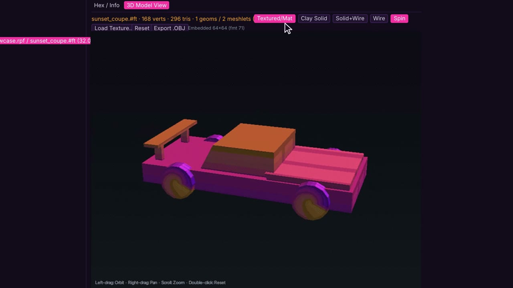
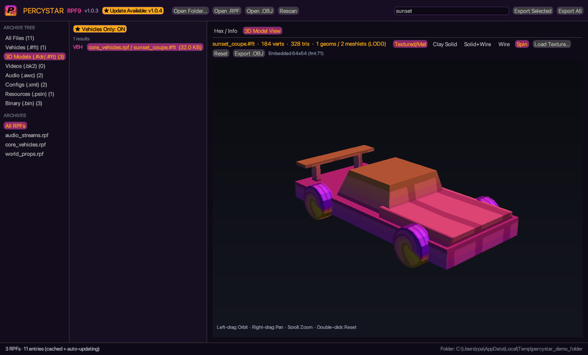

> [!NOTE]
> **Development slowed for the time being** — currently working on **[PercyScarlett](https://github.com/rpatty-dev/PercyScarlett)** to get VI working on PC.

<p align="center">
  
</p>

<h1 align="center">PercyStar</h1>

<p align="center">
  <strong>Zero-dependency native Rust RPF9 (<code>9FPR</code>) &amp; TTPF (<code>RDS5</code>/<code>ETPF</code>) explorer — native Xbox Series X <code>PS\x00\x09</code> AMD RDNA2 (GFX10.3) Shader Disassembler &amp; HLSL/SPIR-V Lifter, dedicated 10-category RAGE 9 3D Model Viewer, 100% RDNA2 texture decoder (all 20 DXGI formats), native <code>0DRPz</code>/<code>RBF0</code>/<code>GFx</code> UI &amp; text decoders, <code>CNavMesh</code> 3D viewer, pure-Rust <code>ADAT</code> Opus audio, and docked D3D11 Bink2 player</strong>
</p>

<p align="center">
  
  <a href="https://github.com/sponsors/rpatty-dev"></a>
  
  
  
  
  
  
  
  
</p>

<p align="center">
  <strong>Latest Release: <a href="https://github.com/rpatty-dev/PercyStar/releases/latest">Download PercyStar v1.4.7 (Win64 + In-App Auto-Updater)</a></strong> · <strong><a href="https://github.com/rpatty-dev/PercyStar/releases/download/v1.0.3/PercyStar_macOS.zip">macOS Universal Build</a></strong><br />
  <strong>Companion Scarlett Layer: <a href="https://rpatty-dev.github.io/PercyScarlett/">PercyScarlett (100% SM 6.6 DXIL Proof)</a></strong> · <strong><a href="https://percystar-breakthroughs.vercel.app">Breakthroughs Dashboard</a></strong> · <strong><a href="https://mapnavmeshsite.vercel.app">NavMesh World Map</a></strong><br />
  <sub>Windows users on v1.0.3+ can click the golden <b>★ Update Available</b> pill inside PercyStar for 1-click self-update.</sub>
</p>

<p align="center">
  
</p>

---

## Promo

<p align="center">
  <a href="assets/promo.mp4"></a><br />
  <sub><a href="assets/promo.mp4">Watch the 31-second promo (MP4)</a></sub>
</p>

---

## Visual Showcase

### RAGE 9 3D Meshlet Viewer (`Textured/Mat` · `Clay Solid` · `Solid+Wire` · `Wire`)
<p align="center">
  
</p>

### Pure-Rust Audio (`ADAT` Opus → WAV), `PSIN` Metadata & XML Inspector
<p align="center">
  
</p>

<details>
<summary>Static High-Res Screenshot (Neon Sunset v1.0.3)</summary>
<p align="center">
  
</p>
</details>

---

## What's New (v1.6.0)

- **World Viewer memory & smoothness** (PR #52 by @asm512): Idle models are evicted from VRAM, and meshes are prepared off the render thread, so large flights no longer stall or run out of memory.
- **PSIN tree view** (PR #51 by @asm512): Collapsible tree view with in-place edits.
- **GXT export & in-file search** (PR #54 by @asm512, closes #50): Export GXT UI/text tables as readable text and search inside file contents from the Explorer.
- **GXT small-table fix** (PR #56 by @Snorps37, closes #55): Small text tables now decode through their string pool records (about 2,300 tables that failed before).
- **ADAT audio fix** (PR #57 by @worstgirlinamerica, closes #48): Misaligned ADAT stream tables are recovered when the forward scan misses streams.

## What's New (v1.5.0) — Speed Release

Every hot path was timed on a real GTA VI build (Ryzen 5 3600XT, 16 GB RAM, game on a 7200 rpm HDD), then made faster without changing a single result. Best of 3 runs, warm files, same machine, back to back:

| Task | v1.4.8 | v1.5.0 | Faster |
|---|---:|---:|---:|
| Load scan index at startup (1.32M entries) | 1671 ms | 640 ms | **2.6x** |
| Build search index | 687 ms | 62 ms | **11x** |
| Search query (`adder`) | 54.5 ms | 12.4 ms | **4.4x** |
| Search query (`tex_ bc7 -mip`) | 61.4 ms | 11.9 ms | **5.2x** |
| Save scan index | 4227 ms | 509 ms | **8.3x** |
| Open 40 texture dictionaries (textures.rpf) | 15428 ms | 5980 ms | **2.6x** |
| Decode 60 TTPF textures | 9.8 ms | 5.1 ms | **1.9x** |
| Scan data.rpf (459 MB) | 4517 ms | 1887 ms | **2.4x** |
| Scan shaders.rpf (393 MB) | 1347 ms | 945 ms | **1.4x** |
| Scan script.rpf | 34.5 ms | 19.8 ms | **1.7x** |
| Scan common.rpf | 82.2 ms | 49.6 ms | **1.7x** |
| Scan packs.rpf (4.5 GB, disk bound) | 40.4 s | 33.3 s | **1.2x** |

**Proof the output is identical:** the benchmark prints a checksum of every scan result, every decoded pixel and the whole search index. All of them match between v1.4.8 and v1.5.0, and a save then reload of the scan index gives back the same data. Full raw output: [`docs/bench/v1.4.8_vs_v1.5.0.txt`](docs/bench/v1.4.8_vs_v1.5.0.txt).

**Run it yourself:** `PercyStar.exe --bench "<game folder>" [runs] [filter]` (filter is a comma list such as `cache,txd,data.rpf`).

What changed:
- **BC1 / BC2 / BC3 / BC4 / BC5 / BC6H / BC7 decoding uses every CPU core** (image split into bands of block rows). BC7 was 80% of texture dictionary load time.
- **zlib now uses the `zlib-rs` backend** (pure Rust, faster inflate) for all archive reads.
- **Archive scanning probes every 4 KB page on all cores** and reads the next 16 MB chunk on its own thread while the current one is probed, so the disk never waits. Same for the levels.rpf vehicle index.
- **Scan index (`scan_cache_v9.tsv`) loads and saves on all cores**; a failed save no longer replaces a good cache with a cut one.
- **Search index, filtering and the Model Viewer list are built on all cores**; sorting skips the merge buffer while keeping the exact same order.
- **Verified Test Suite**: `98 passed; 0 failed` (`cargo test --release`).

## What's New (v1.4.8)

- **Stale Decode & World Streamer Reliability (PR #43, `@asm512`)**:
  - Dropped superseded out-of-order selection decodes (model, navmesh, TXD/TTPF, AWC) and ensured decoder panics clear the spinner.
  - Re-queued skipped world streamer models when the camera moves mid-batch, eliminating permanent map holes.
- **World Textures, Cell Batching & Background Export (PR #43 + PercyStar Optimizations)**:
  - World streamer reads capped 128px mips directly (`decode_ttpf_texture_capped`) with shared texture uploads, 1 GiB byte-bounded TTPF cache, thread-local `File` handle reuse (`LAST_TTPF_FILE`), and `Rc<PathBuf>` chunk cache keys.
  - 1024 m cell batching for per-cell culling (draw cap `6000`), lock-free per-worker streaming completion (`(cores / 2).clamp(3, 6)` threads, zero per-archetype mutex/sleep), background Export All/Selected with Cancel, and 45s scan-cache autosave.
- **RF World View (`src/worldmap.rs`, `src/world_gpu.rs`)**:
  - Added **RF World View** button alongside `Launch 3D GPU World (wgpu)` with Time-of-Day presets (`Dawn`, `Noon`, `Golden`, `Night`), `Water (V)` toggle, `700m`–`16km` draw radius presets, and `C`-down flight controls powered by `PercyStar`'s PBR/sky/water/RT shaders.
  - Fixed `CEntityDef` world entity orientation (conjugated + finite-guarded quaternions) and replaced linear archetype distance scans with a `200m` spatial grid streaming nearest-cell-first up to `6 km`.
- **Verified Test Suite**: `98 passed; 0 failed` (`cargo test --release`).

## What's New (v1.4.7)

- **Code Health Pass**
  - Text-file readers (`lines()` in `src/main.rs`) now stop on an I/O error instead of retrying forever on a failing read.
  - Removed dead code: unused `play_wav_async` (Windows + Unix), unused `parse_sgd5`, and the never-sent `Sgd5Count` world-stream message and its empty title-bar label.
  - Applied mechanical lint cleanups across 13 modules (`div_ceil`, `is_multiple_of`, `as_chunks`, range checks, simplified `map_or`), with no behaviour change.
  - Test module in `src/main.rs` moved to the end of the file.
- **Explorer Marquee Scroll Lock (#41, `src/main.rs`)**: Locks vertical scrolling on the Explorer list while a marquee drag selection is active (`Escape` or pointer release restores scrolling immediately).
- **Verified Test Suite**: `96 passed; 0 failed` (`cargo test`).

## Model Viewer & Export Quality

- **Smooth-Shaded, Filtered, Anti-Aliased Model Viewer (`src/model3d/raster.rs`, `shading.rs`, `texture.rs`)**
  - Shading normals rebuilt from topology: faces that share a GPU vertex smooth together, vertices duplicated at one position (UV seams, per-geometry quantization) are welded within a tolerance, and hard edges stay hard. A **Smooth** toggle shows the real facets.
  - Trilinear texture filtering over a linear-light mip chain, perspective-correct UVs/normals/depth, per-pixel lighting in linear light with tangent-space normal maps, a clearcoat for vehicle paint, and straight-alpha textures so an alpha channel that carries data never darkens the color.
  - Watertight fixed-point rasterizer (top-left fill rule, no pinholes in dense meshes, no double blending on glass), rendered on all CPU cores, supersampled when the camera rests and adaptive resolution while it moves.
- **Export With Normals, Materials & Textures (`src/model3d/export.rs`)**
  - **Export .OBJ** writes shared `vn` normals, bottom-left `vt`, a `.mtl` library and the applied textures as PNG. **Export .GLB** writes binary glTF 2.0 (Y-up, one node per drawable, embedded PNG textures, `MASK`/`BLEND` alpha modes) that opens directly in Blender and game engines.
- **Open From the Command Line or by Drag & Drop (`src/main.rs`)**
  - `PercyStar <path>` ("Open with", or dragging a file onto the exe) and dropping a file or folder onto the window open a game folder, an `.rpf`/`.ttpf` archive, an `.obj` model or a `.ps09` cache directly.
- **Texture Decoder Fixes (`src/tex.rs`)**
  - `BC2`/`BC3` color blocks are always decoded four-color, `BC4_SNORM`/`BC5_SNORM` are decoded signed, and single-channel `BC4` masks are no longer bound as normal maps.

## Features & Format Breakthroughs (v1.3.8)

- **Format 99 `float3` Meshlet Positions & Signed UVs (`src/model3d/vertex_stream.rs`)**
  - Bounded vertex-stream decoder supporting raw `float3` (format `99`) alongside packed format `66` (cables, water, compact headers without quantization), signed format-`40` / float format-`66` UVs, and atomic rejection of corrupt/non-finite streams.
- **4 GiB+ TTPF Logical Texture Addressing (`src/tex.rs`)**
  - Reads full `40-bit` TTPF logical size and `21-bit` page addresses so `>4 GiB` map/vehicle texture descriptors resolve without wrapping.
- **3D World Map & Hillshaded Terrain (`src/worldmap.rs`)**
  - Interactive **World Map** tab with `2048×2048` `MHIU` elevation map, clickable `NavMesh` sector overlay, `3D Terrain` (`256×256` mesh with baked `512×512` sun-angle hillshaded texture + daylight skybox + `WASD/Q/E` fly camera), and async background-loaded **3D City Blocks (Brickell SLOD)**.
- **3D Cutout Transparency, Glass & Decal Blending (`src/model3d.rs`, `src/tex.rs`)**
  - Preserves BC1 1-bit cutout alpha & A8 opacity masks, hides shadow-only proxy meshes in `Textured/Mat` preview, and composites decals + translucent glass far-to-near.
  - Added **Videos** shortcut in Model Viewer and unified **Open File...** support for `.rpf`, `.ttpf`, `.obj`, and `.ps09`.
- **Upgraded AWC Waveform Audio Player & Superblock Splitting (`src/awc.rs`, `src/audio_player.rs`)**
  - Detailed `ADAT` header/chunk hex diagnostics with **Copy** button, `0x80000` (512 KB) superblock stream de-interleaving, virtualized `ScrollArea::show_rows` stream list with search filter, 200-bin peak/RMS waveform seek bar with smooth drag scrubbing, live dBFS meter, `Loop` / `Auto` advance, `Space`/`Left`/`Right` shortcuts, and **Export WAV**.
- **Keyboard Asset Navigation (`src/main.rs`)**
  - Fast `ArrowUp`/`ArrowDown`/`PageUp`/`PageDown`/`Home`/`End` (plus `W`/`S` when not in 3D view) browsing across Explorer & Model Viewer lists with auto-scroll.

## Features & Format Breakthroughs (v1.3.5)

- **`MHIU` `2048×2048` World Heightmap Decoder (`src/tex.rs`)**
  - Decodes row-compressed `MHIU` terrain heightmaps (`-13000..+7000` X, `-9000..+11000` Y, `-50..+500m` Z) into a colorized `2048×2048` elevation texture with zoom & PNG export.
- **`DAT` Audio Metadata (`src/dat.rs`), `Cutscene` `.cutc` & `phBound` AABB (`src/rsc9.rs`)**
  - Decodes `DAT25`/`26`/`41`/`61` `.rel` hash->object index tables, `story000` cutscene cast/prop/`.anim` manifests, and `phBound` collision AABBs.
- **Live 3D Stick-Man Dummy Animation Player (`src/anim.rs`)**
  - Z-up articulated 3D stick-man rig with Play/Pause + timeline scrubber driven by decoded `crClipDictionary` durations, track counts, and clip hashes.

- **`SGD5` Shader-Group & `DXBC` / `NOBC` / `FSSM` RDNA2 Pipeline**
  - Fast `0x1000`-aligned `SGD5` page scanner (`src/sgd5.rs`), indexed XDAT/XBCH native-program extraction, and `OnceLock`-cached `dxcompiler.dll` lookup (`src/dxbc.rs`) feeding the GFX10.3 RDNA2 disassembler and experimental HLSL / SPIR-V lifter.
- **Full `PSIN` Binary PSO Schema, Enum & Instance Decoder (`src/psin.rs`)**
  - Decodes `PSIN` instance tables (`pppppppp`-delimited, 16-byte aligned payloads), `LSCH` 32-byte struct headers & 16-byte field descriptors, `LENM` enum tables, and resolves JOAAT field/struct/enum hashes across `3,900+` binary PSO configs (`script.rpf`, `story000_script.rpf`, `data.rpf`).
- **`crClipDictionary` (`ANIM`) Decoder (`src/anim.rs`)**
  - Detects and decodes `0DRPz`-backed `crClipDictionary` resources (`anim.rpf`), extracting clip counts, hash tables, flags, and animation block pointers.
- **`0x71717171` Pointer-Tagged `RSC9` Table Decoder (`src/rsc9.rs`) & Smart `RBF0` Naming**
  - Decodes `0x71717171` pointer-relocated `RSC9` hash/data dictionaries (e.g. `30,683`-entry `script.rpf` table) and auto-names `RBF0` / XML config streams by root struct slug.
- **CLI Bring-Up & Format Examples 😉**
  - `PercyStar.exe --inspect-exe <example_binary.exe>` — inspects PE64 sections, GDK/console imports, `9FPR` / `scrProgram` anchors, and `MicrosoftGame.Config` layout 😉
  - `PercyStar.exe --extract-sgd5 <shaders.rpf> <out_dir>` — extracts `SGD5` DXBC/FSSM RDNA2 shaders 😉

- **Native Xbox Series X `PS\x00\x09` AMD RDNA2 (GFX10.3) Shader Disassembler & HLSL / SPIR-V Lifter (`Shaders (RDNA2)` Tab)**
  - Parses the complete `PS\x00\x09` PSO cache (`25,471` Graphics PSOs, `2,693` Compute PSOs, `54,576` metadata blobs, `21,522` compiled AMD GFX10.3 shaders), including `0x41` `USER_DATA` root-signature bindings (`SRV`/`CBV`/`UAV`/`Sampler`), `COMPUTE_PGM_RSRC1/2`, and `[numthreads(x,y,z)]`.
  - Auto-tags every shader stage (**PS**, **VS**, **CS**, **NGG/Meshlet** `exp prim`, and **Hardware RT** `image_bvh64_intersect_ray`).
  - Live 3-view inspector (**`GFX10.3 ASM`** · **`Lifted HLSL (SM 6.6)`** · **`SPIR-V 1.5 / SGPR ABI`**) + 1-click **Export `.hlsl` / `.spv` / `.asm`** and CLI batch exporter.
- **Dedicated 3D Model Viewer Tab (`Explorer | Model Viewer | Shaders (RDNA2)`)**
  - Full-screen 3D workspace built for instant 60 FPS browsing across **144,000+ RAGE 9 3D models**.
  - **10 Strict RAGE 9 Categories** with live counts: **All Models**, **Vehicles**, **Air & Sea**, **Weapons**, **Characters**, **Clothing**, **Animals** (`cr[mbfraci]_` taxonomy), **Props & Items**, **World / Map**, and **NavMesh 3D**.
  - **Hide LODs/Bounds** toggle (filters `_lod`/`_slod`/`batchlod`/`bipedbounds`/`collision_`), `◀ Prev` / `Next ▶` / `Random` buttons, `Up`/`Down` arrow-key browsing, **5 Camera Presets** (`3/4`, `Front`, `Side`, `Back`, `Top`), and **1-Click Catalog CSV Import** + `.OBJ` loader.
- **100% Console RDNA2 Texture Engine (`.#td` & `.ttpf`)**
  - **100.00% TTPF Format Identification (357,115 / 357,115 textures):** Solved ETPF descriptor `u1` bits 3..9 (`(u1 >> 3) & 0x7F` = exact Microsoft `DXGI_FORMAT` enum) — zero unknown texture formats.
  - **All 20+ DXGI Formats Decoded Natively in Pure Rust:** `BC1`–`BC7`, `BC6H_UF16`/`SF16` HDR, `R16G16B16A16_FLOAT`/`UNORM`, `R16_FLOAT`/`UNORM`, `R16G16_FLOAT`, `R32_FLOAT`, `R10G10B10A2_UNORM`, `R8G8B8A8`, `B8G8R8A8`, `R8_UNORM`, `A8_UNORM` (`texture2ddecoder` + IEEE-754 half-float Reinhard tonemapping).
  - **Verified RDNA2 4KB (`SW_4KB_D`) & 64KB Deswizzle for All 5 Bit Depths (8 / 16 / 32 / 64 / 128bpp):** Plus reverse-mip `mip0` tail addressing, instant `O(log N)` RDS5 chunk seeking, exact RDS5 chunk codec decoding (`0=RAW`, `1..7=HW BCPack BC1..BC7`, `8=ZLIB`), interactive zoom viewer, multi-texture strip, and **Export PNG / Export DDS (DX10)**.
- **Expanded RAGE 9 3D Meshlet Decoder (`.#dr`, `.#ft`, `.#dd`, `.obj`)**
  - Direct click-to-view decoding of unencrypted RAGE 9 virtual (`0x50xxxxxx`) + physical (`0x60xxxxxx`) meshlet resources straight out of `.rpf` archives, including `+0xA8` drawable name resolution and non-zero page header support (**38× more models discovered**).
  - Clean **LOD0-only** extraction (`Lod0 -> grmModel -> grmGeometry`), 24/24/16-bit quantized vertices, 7-bit packed meshlet triangles + `u16` remap table, **UV0** (`type 0x28`), upgraded embedded `SW_4KB_D` BC7/BC3/BC1 textures, custom `.png`/`.bmp` texture loading, and full `.OBJ` export (`v` + `vt` + `f v/vt`).
- **Native UI, Localization & NavMesh Decoders (`RBF0`, `GFX`, `0DRPz`, `CNavMesh`)**
  - **`0DRPz` Text / GXT Viewer:** Decodes multi-chunk RAGE 9 UTF-8 localization tables & standalone string pools under **UI & Text (`RBF0/GFX/GXT`)** with searchable preview-slug filenames.
  - **`RBF0` (`fwui`) → XML:** Handles the 4-byte `0xFB 0xFF 0x01 0x00` header to decode binary UI resources cleanly into XML (with `.xml` export).
  - **Scaleform GFx v42 (AS3) Inspector:** Dumps ActionScript 3 classes, packages, and symbol references.
  - **`CNavMesh` (`0x00010015`) 3D Viewer:** Detects navigation tiles with world grid coordinates (`nav_{gx}_{gy}_(x,y).ynv`), triangulates polygons colored by surface type (land/water/road/pavement/interior), and exports `.OBJ`.
- **100% Native Runtime Dependencies for Audio, 3D, Textures, UI, XML & PSO**
  - **No Python, no FFmpeg, no external DLLs required** — `ADAT` (`.awc`) Opus streams decode natively via pure-Rust `rusty-opus` (RFC 6716). All crates pinned in [`Cargo.lock`](Cargo.lock).
- **Whole-Folder & Single-Archive Scanning (`.rpf` & `.ttpf`)**
  - Multi-threaded live scanning cached to `%LOCALAPPDATA%\PercyStar\scan_cache_v8.tsv`.
- **Docked D3D11 Bink2 Video Player (Optional `radvideo64.exe` / `binkplay.exe`)**
  - Plays clips with RAD Video Tools' `radvideo64.exe binkplay <clip>` when available, falling back to `binkplay.exe`, and docks the player window directly into the inspector pane. Run [`scripts/setup_deps.ps1`](scripts/setup_deps.ps1) if needed.
- **CLI Batch Exporters (Models, Textures & RDNA2 Shaders)**
  ```powershell
  PercyStar.exe --extract-vehicles "<path-to-levels.rpf>" "<output-dir>"
  PercyStar.exe --extract-models "<path-to-archive.rpf>" "<output-dir>" "filter1,filter2"
  PercyStar.exe --dump-textures "<path-to-archive.rpf|.ttpf>" "<output-dir>" [limit]
  PercyStar.exe --disasm-shaders "<path-to-shaders.rpf|zlib_dir|.ps09>" "<output-dir>" [limit]
  PercyStar.exe --extract-sgd5 "<path-to-shaders.rpf|SGD5.bin>" "<output-dir>" [limit]
  PercyStar.exe --disassemble-dxbc "<path-to-shader.dxbc>" ["<output.asm>"]
  ```
  The Shaders tab is source-driven: opening a raw `shaders.rpf` loads the PS09 runtime cache and every SGD5 group, while separate buttons load a PS09 cache, zlib directory, or SGD5 `.bin`. Selecting either source or any shader switches the browser and viewer to that dataset. Both sources support GFX10.3 disassembly plus experimental HLSL and SPIR-V lifting; SGD5 extraction gives each group its own output folder and `sgd5_index.csv`. GTA `Wrapped`/`NOBC` shaders are unwrapped to their zlib `FSSM` payload before RDNA2 decoding.

  SGD5 uses one reflection-table parser for shared metadata, individual shaders, and both effect tables. Its sections are named `resources`, `members`, and provisional `auxiliary_records`; members describe CBV contents or Buffer element metadata. Resource records expose byte-sized slot, auxiliary count, member count, and flags fields. Member records expose separate value-type and auxiliary-count bytes. Observed-zero words are retained as reserved fields, and default-data offsets are interpreted only on members. Descriptor tables and inline property tables share the `Sgd5BindingTable` model; property references resolve through the table's 32-bit hash. Auxiliary/default bytes are retained alongside typed property values and known member extents. The second reflection hash remains independent, and the 144-byte engine shader metadata is retained with decoded fields. CSV manifests use `archive_size`, `decompressed_size`, `resources`, `members`, and `auxiliary_records` columns.

  Run parser regressions with `cargo test sgd5`. To validate the analysis archive, set `PERCY_SGD5_SAMPLE` to its path and run `cargo test sample_archive_uses_common_tables_and_decompresses_each_stage -- --ignored`.

  The SGD5 viewer has a **Metadata** view and text export with compiled DXBC input/output signatures, resource hashes and types, member packing/default bytes, shared reflection matches, effect ownership, and resolved binding-table references. ASM/HLSL exports include that metadata as comments. Parameter inspection distinguishes effect material slots from compiled shader registers and root indices, using reflection and `PRIV` to establish binding identities. See [the SGD5 format notes](docs/SGD5.md) for what is confirmed and what remains inferred.

  FSSM extraction follows the XDAT/XBCH index and validates compressed/uncompressed sizes, then uses the active program descriptor's declared range. The explorer makes every native variant selectable, displays its actual hardware stage, and exports the selected program. Metadata includes compiler root/resource tables, user-data/SGPR locations joined to original `PRIV` bindings and reflection names, register counts, wave/LDS configuration, stage I/O, mesh limits, and pixel export alternatives. Disassembly retains compiler no-ops and instructions before prefetch, and continues past early `s_endpgm` instructions to the code-end padding. See [native compiler metadata](docs/FSSM.md) for layouts, verified archive counts, and regression commands.

  Executable analysis now supports explicit SGD5 state, technique, and pass tables. The SGD5 browser follows effect → technique → pass → shader, with separate variant libraries and shared archive tables. Inspect material parameters, typed `proplst` properties, vertex inputs, render states, and selected binding layouts. Shader Parameters, ASM, and lifted HLSL show verified resource/register/root mappings and the selected pass context. The shader's serialized profile byte is named `shader_version`; compiled wave size comes from FSSM metadata. Effect binding lists use a 24-bit count and an 8-bit texture-handle count, and the shared-reflection selector is parsed explicitly. See [the serialized layout](docs/SGD5-layout.md) and [runtime pipeline](docs/SGD5-pipeline.md).

---

## Project Layout

```text
PercyStar/
├── assets/
│   ├── logo.png            # App & window icon
│   ├── logo.ico            # Windows executable icon
│   ├── demo_overview.webp  # 30fps Neon Sunset UI, search & updater showcase
│   ├── demo_3d.webp        # 30fps 3D meshlet viewer shading modes showcase
│   ├── demo_inspector.webp # 30fps XML / PSIN / ADAT Opus audio showcase
│   ├── preview.png         # High-res Neon Sunset screenshot
│   ├── promo.mp4           # 31s promo video
│   └── promo-poster.jpg    # Promo poster frame
├── promo/                  # HyperFrames source for the promo video
├── scripts/
│   ├── build_macos.sh      # Universal macOS (.app / .zip) build helper
│   ├── setup_deps.ps1      # Optional RAD Video Tools (radvideo64.exe / binkplay.exe) setup
│   ├── awc_extract.py      # Standalone CLI ADAT (.awc) Opus -> .wav helper
│   └── rpf9_carve.py       # Standalone CLI RPF9 carver
├── docs/
│   └── breakthroughs.json  # Live-synced research & breakthroughs timeline feed
├── src/
│   ├── main.rs             # PercyStar egui app, Model Viewer, RDNA2 Shader Lifter, RPF9/TTPF scanner & CLI
│   ├── rdna2.rs            # Console RDNA2 PS\x00\x09 parser, AMD GFX10.3 disassembler, HLSL SM 6.6 & SPIR-V 1.5 lifter
│   ├── sgd5.rs             # SGD5 shader-group container & DXBC/FSSM extractor
│   ├── dxbc.rs             # DXBC / NOBC / FSSM RDNA2 shader disassembler
│   ├── psin.rs             # PSIN binary PSO schema, enum & instance decoder
│   ├── anim.rs             # crClipDictionary (0DRPz) animation header decoder
│   ├── dat.rs              # RAGE 9 audio metadata (DAT25/26/41/61) decoder
│   ├── rsc9.rs             # RSC9 0x71717171 table & phBound AABB inspector
│   ├── boot.rs             # PE64 bring-up & manifest inspector (--inspect-exe) 😉
│   ├── model3d.rs          # RAGE 9 meshlet decoder, UV/TXD parser & model viewer UI
│   ├── model3d/
│   │   ├── vertex_stream.rs # Packed / float3 vertex-stream decoder
│   │   ├── shading.rs      # Smooth shading normals rebuilt from topology
│   │   ├── texture.rs      # Straight-alpha textures, mip chain & trilinear sampler
│   │   ├── raster.rs       # Multithreaded software renderer (visibility buffer, supersampling)
│   │   └── export.rs       # OBJ + MTL and binary glTF (.glb) exporters
│   ├── tex.rs              # Console RDNA2 4KB/64KB textures, TTPF, RBF0, GFx, 0DRPz & CNavMesh
│   └── awc.rs              # Pure-Rust ADAT (.awc) Opus -> .wav decoder
├── app.rc / build.rs       # Win32 icon resource
├── Cargo.toml / Cargo.lock # All Rust crate dependencies pinned cleanly
└── LICENSE
```

---

## Building from Source

Requires **Rust 1.89 or newer** (`x86_64-pc-windows-gnu` with MinGW `windres`/`dlltool`, or `msvc`). Cargo fetches all pinned dependencies from `Cargo.lock`:

```powershell
cargo test
cargo build --release
```

Compiled standalone binary: `target/release/PercyStar.exe`. `scripts/build_linux.sh` and `scripts/build_macos.sh` package the other platforms. Every push and pull request is built and tested by [`.github/workflows/ci.yml`](.github/workflows/ci.yml).

---

## Support & Donations

PercyStar is completely free and open-source. If it's helped your research or saved you time and you'd ever like to kindly support ongoing R&D, server/hardware costs, and late-night builds, **[sponsoring via GitHub Sponsors](https://github.com/sponsors/rpatty-dev)** is always deeply appreciated — no pressure at all, starring the repo or sharing test reports helps just as much!


Optional external tools are only loaded from trusted locations: `radvideo64.exe` (preferred, run as `radvideo64.exe binkplay <clip>`) next to `PercyStar.exe`, on `PATH`, in the RAD install folders or from `RADVIDEO64_PATH`; `binkplay.exe` next to `PercyStar.exe`, on `PATH`, in the RAD install folders or from `BINKPLAY_PATH`; `dxcompiler.dll` next to `PercyStar.exe`, in `System32` or from `DXCOMPILER_DLL`; `bink2w64.dll` next to `PercyStar.exe` or from `BINK2_DLL`. They are never picked up from the working directory or from the folder of an opened file.

---

## Credits & Community

- **Original Creator:** [@rpatty-dev](https://github.com/rpatty-dev) (`@rpatty`)
- **Code & Research Contributors:**
  - [@Pokeralho](https://github.com/Pokeralho) (`Luis F.`, PR #42) — Smooth-shaded trilinear visibility-buffer 3D model renderer (`raster.rs`, `shading.rs`, `texture.rs`), OBJ+MTL+PNG & binary glTF 2.0 (`.glb`) export (`export.rs`), straight-alpha & BC2/BC3/BC4/BC5 decoder fixes, CLI/drag-and-drop path opening, Linux build fix, parser/updater security hardening, and headless viewport/siren tests.
  - [@clayeon](https://github.com/clayeon) (PR #34) — Emergency lights with siren sequencer timing, modular fragment/roofbar composition, and `packs.rpf` `0x7a` authored vehicle configurations.
  - [@Snorps37](https://github.com/Snorps37) (PR #56, Issue #55) — GXT small-table decoding through string pool records.
  - [@worstgirlinamerica](https://github.com/worstgirlinamerica) (PRs #30, #31, #32, #33, #57) — ADAT misaligned stream-table recovery, `scripts/build_linux.sh`, AWC superblock directory & stereo channel fix in `awc_extract.py`, `cfg(windows)` gating, and explicit `f32` literal fix.
  - [@Xyzstk](https://github.com/Xyzstk) (PRs #8, #29) — `SGD5` shader-group parser, `DXBC`/`FSSM` extraction, and reflection resource naming.
  - [@techfoundrynz](https://github.com/techfoundrynz) (PRs #12, #13, #21–#28) — `>4 GiB` TTPF addressing, format 99 `float3` meshlets, world-scale MHIU terrain in GPU World, north-up 2D map & heightmap alignment, Model Viewer sidebar stability, window/taskbar icons, startup feedback, and `Cargo.lock` sync.
  - [@asm512](https://github.com/asm512) (PRs #19, #43, #45, #47, #51, #52, #54) — World Viewer model eviction & off-thread mesh prep, PSIN tree view, GXT text export & in-file search, PSIN typed XML, vehicle data panel, in-file & sibling vehicle LOD switching (`Hi`/`Mid`/`Low`, `LOD0`–`LOD3`), per-texture material layers + Texture Browser, stale-decode & streamer-hole fixes, 1024m cell batching, mip-capped TTPF reads, and background export with cancel.
  - `@igvcc` (Discord) — `Bink2` container parser (`bink2_container.rs`), `BCPack` Row-3 base-seed fallback (`tex.rs`, optimized to 16×16 swatch), and `--decode-audio` / `--decode-navmesh` batch CLI extractors.
  - [@nullbrik](https://github.com/nullbrik) ([RageForge](https://github.com/nullbrik/RageForge)) — Clean-room UX inspiration for `RF World View` (Time-of-Day presets, Water toggle, 700m–16km draw radius presets, and `C`-down flight controls).
  - [@GamingChelsea](https://github.com/GamingChelsea) (PRs #10, #18) — `audio.rpf` DAT metadata catalog & AWC auto-naming, AWC decode diagnostics, superblock stream splitting, and waveform audio player foundation.
  - [@Ahmet-Dedeler](https://github.com/Ahmet-Dedeler) ([Percy6Stars](https://github.com/Ahmet-Dedeler/Percy6Stars), PRs #6, #7, Issue #9) — macOS build & 3D viewer decoding, sorting, `RADTools.exe` fix, cutout/glass/decal blending, and licensing feedback.
  - [@paryzius](https://github.com/paryzius) ([ttpf-viewer](https://github.com/paryzius/ttpf-viewer)) — `.ttpf` reduced-mip fallback for unreadable mip 0 chunks.
  - [@holdmysocks](https://github.com/holdmysocks) ([SixNG](https://github.com/holdmysocks/SixNG)) — `0DRPz` (`0x7a`) map placement schema for world entity streaming.
- **Bug Reports & Feature Suggestions (Issues):**
  - [@YellowMaker](https://github.com/YellowMaker) (#20 — 2D world map orientation, #50 — GXT text export), [@crexlight](https://github.com/crexlight) (#48 — ADAT u16 stream tables), [@adamjuankili](https://github.com/adamjuankili) (#17 — GPU World `m_vb` VRAM crash), [@crexlight](https://github.com/crexlight) (#16 — police dispatch `.awc` sample rate), [@Bluredguy](https://github.com/Bluredguy) (#15 — `binkplay.exe` path lookup), [@rbence05](https://github.com/rbence05) (#14 — PSIN placed scene assembly), [@kotelkonrad](https://github.com/kotelkonrad) (#11 — keyboard/arrow navigation across Explorer, models, audio & video), [@CedarCoder1](https://github.com/CedarCoder1) (#5 — copy file names & paths), [@Mrsuss60](https://github.com/Mrsuss60) (#4 — sort by name & size), [@adastmin1](https://github.com/adastmin1) (#2, #3 — multi-language & audio/text feedback).

---

## Scope, Clean-Room Research & Legal Notice

PercyStar is an **independent, clean-room binary inspection and parser tool** built from scratch in Rust. It only parses **unencrypted, user-supplied files** (`KB2*` streams, `ADAT` audio, plain `zlib` XML/PSIN containers, and standard uncompressed meshlet vertex/index blocks) for research and interoperability (cf. 17 U.S.C. § 1201(f)):

- **Zero Circumvention / Zero Keys:** Contains **no** decryption routines, encryption keys, hashes, DRM bypasses, or access-control workarounds. Encrypted data is skipped untouched.
- **Zero Proprietary Content:** Ships **no** third-party binaries, copyrighted models, textures, audio, shaders, or game assets. Users are solely responsible for supplying archives they legally own or are authorized to inspect.
- **Independent Trademark Disclaimer:** PercyStar is an independent open-source project and is not affiliated with, endorsed by, or sponsored by any game studio or publisher.

**Copyright (c) 2026 rpatty-dev — All Rights Reserved.**  
See [LICENSE](LICENSE). You may download, run, and fork this repository on GitHub for personal use/reference, **but you may not modify, alter, or redistribute modified versions of the code or binaries without explicit written permission.**
